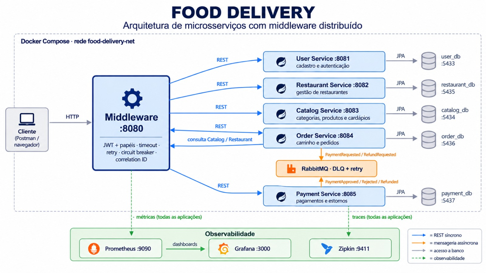
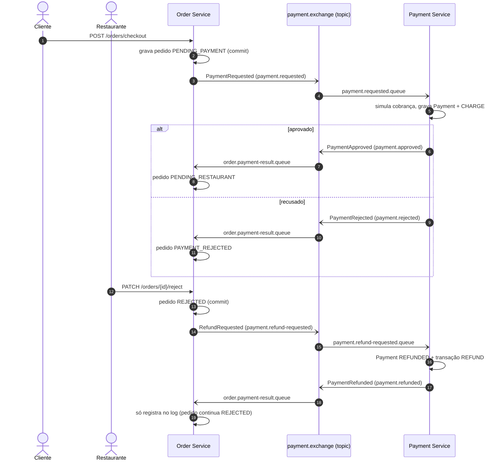

# Food Delivery

Plataforma de delivery de comida construída como **middleware distribuído** para a disciplina de Sistemas Distribuídos (UNICAP, 2º GQ). Clientes criam conta, consultam restaurantes e cardápios, montam o carrinho e fazem pedidos; o pagamento é processado de forma assíncrona e o restaurante aceita e prepara o pedido.

**Stack:** Java 21 (User Service em Java 17) · Spring Boot · PostgreSQL 16 (um banco por serviço) · RabbitMQ · Docker Compose · Prometheus · Grafana · Zipkin

| | |
|---|---|
| Relatório técnico | [`docs/relatorio-tecnico.pdf`](docs/relatorio-tecnico.pdf) |
| Diagrama de arquitetura | [`docs/arquitetura.png`](docs/arquitetura.png) |
| Middleware (rotas, resiliência, falhas) | [`middleware/README-middleware.md`](middleware/README-middleware.md) |
| User · Order · Payment | [`user-service/Readme-user-service.md`](user-service/Readme-user-service.md) · [`OrderService/README-order-service.md`](OrderService/README-order-service.md) · [`PaymentService/README-payment-service.md`](PaymentService/README-payment-service.md) |

**Sumário:** [Arquitetura](#arquitetura) · [Como executar](#como-executar) · [Requisitos atendidos](#requisitos-atendidos) · [Microsserviços](#microsserviços) · [Fluxo completo](#fluxo-completo-do-sistema) · [Middleware](#middleware) · [Mensageria](#mensageria) · [Consistência e falhas](#estratégia-de-consistência)

## Arquitetura



- **Cliente → Middleware (:8080):** toda comunicação síncrona entra pelo middleware, escrito do zero pelo grupo. Ele aplica JWT e papéis, timeout, retry, circuit breaker, fallback e correlation ID, e encaminha para o serviço certo.
- **5 microsserviços independentes**, cada um no seu container e com o seu banco PostgreSQL.
- **Order → Middleware → Catalog / Restaurant:** no checkout, o Order valida produtos, preços e restaurante via REST, também passando pelo middleware.
- **Order ⇄ RabbitMQ ⇄ Payment:** o pagamento é assíncrono, com DLQ, retry e idempotência.
- **Observabilidade:** Prometheus coleta as métricas de todas as aplicações, Grafana mostra os dashboards e Zipkin recebe os traces.

## Como executar

Pré-requisito: Docker Desktop (com Docker Compose).

```bash
docker compose up -d --build     # sobe tudo: middleware, 5 serviços, 5 bancos, RabbitMQ e observabilidade
docker compose ps                # aguarde todos ficarem Up / healthy
curl http://localhost:8080/middleware/health
```

Para a demonstração, todo pagamento pode ser aprovado com `PAYMENT_APPROVAL_RATE=1.0` (o padrão é 0.8, ou seja, 20% de recusas simuladas):

```bash
PAYMENT_APPROVAL_RATE=1.0 docker compose up -d --build          # Bash
```
```powershell
$env:PAYMENT_APPROVAL_RATE = "1.0"; docker compose up -d --build  # PowerShell
```

| Componente | Endereço | Banco (porta no host) |
|---|---|---|
| **Middleware** (entrada única) | **http://localhost:8080** | – |
| User Service | 8081 | `user_db` (5433) |
| Restaurant Service | 8082 | `restaurant_db` (5435) |
| Catalog Service | 8083 | `catalog_db` (5434) |
| Order Service | 8084 | `order_db` (5436) |
| Payment Service | 8085 | `payment_db` (5437) |
| RabbitMQ | 5672 (AMQP) · http://localhost:15672 (guest/guest) | – |
| Prometheus | http://localhost:9090 | – |
| Grafana | http://localhost:3000 (admin/admin) · Dashboards → Food Delivery | – |
| Zipkin | http://localhost:9411 | – |

Contratos das APIs (Swagger) em cada serviço: `http://localhost:808X/swagger-ui.html`. As configurações (URLs, credenciais, timeouts, `JWT_SECRET`) são externalizadas por variáveis de ambiente no `docker-compose.yml`.

Testes automatizados:

```bash
cd middleware && mvn test            # roteamento, 401/403, retry, timeout, circuit breaker
cd OrderService && sh mvnw test      # mensageria com Testcontainers (pulados sem Docker)
cd PaymentService && sh mvnw test
```

## Requisitos atendidos

| Requisito | Como foi atendido |
|---|---|
| ≥ 2 serviços independentes, cada um em seu container | 5 serviços + middleware, cada um com Dockerfile; tudo sobe com `docker compose up` |
| Comunicação síncrona | REST pelo middleware (cliente → serviços; Order → Catalog/Restaurant) |
| Comunicação assíncrona | RabbitMQ: Order publica `PaymentRequested`, Payment consome e publica o resultado |
| Resiliência | Timeout, retry com backoff exponencial, circuit breaker e fallback `503` no middleware; retry + DLQ nas filas |
| Observabilidade | Logs em JSON, correlation ID propagado por HTTP e pela fila, métricas no Prometheus, dashboards no Grafana, tracing no Zipkin |
| Segurança | JWT emitido pelo User Service; papéis `CUSTOMER`, `RESTAURANT_OWNER` e `ADMIN` verificados no middleware e nos serviços |
| Tolerância a falhas | Consistência eventual e comportamento por serviço documentados em [Estratégia de consistência](#estratégia-de-consistência) |
| Idempotência e garantia de entrega | Um pagamento por `orderId`; confirmação do broker, mensagens persistentes, retry e DLQ |

## Microsserviços

### 1. User Service

Cadastro, login com JWT, perfis de acesso e endereços.

- Entidades: `User`, `Address`
- Perfis: `CUSTOMER`, `RESTAURANT_OWNER`, `ADMIN` (não é possível se cadastrar como `ADMIN`)

```
POST   /users/register
POST   /users/login
GET    /users/{id}
PUT    /users/{id}
POST   /users/{id}/addresses
GET    /users/{id}/addresses
```

### 2. Restaurant Service

Cadastro e edição de restaurantes, associação com o proprietário e controle de aberto/fechado. O restaurante é criado fechado; o Order só aceita pedidos de restaurante aberto.

- Entidade: `Restaurant`

```
POST   /restaurants
GET    /restaurants?open=true&ownerId={id}
GET    /restaurants/{id}
PUT    /restaurants/{id}
PATCH  /restaurants/{id}/availability
```

### 3. Catalog Service

Cardápios: categorias, produtos, preços e disponibilidade.

- Entidades: `Category`, `Product`

```
POST   /categories
GET    /categories/{id}
GET    /categories/restaurant/{restaurantId}
PUT    /categories/{id}
PATCH  /categories/{id}/deactivate

POST   /products
GET    /products/{id}
GET    /products/restaurant/{restaurantId}
GET    /products/restaurant/{restaurantId}/available
PUT    /products/{id}
PATCH  /products/{id}/availability
DELETE /products/{id}

GET    /restaurants/{restaurantId}/menu
```

### 4. Order Service

Carrinho e pedidos no mesmo serviço, já que o carrinho só existe para chegar ao checkout. No checkout, valida produtos, preços e restaurante via REST e publica `PaymentRequested`. Cada `OrderItem` guarda uma cópia do nome e do preço do produto, então mudanças futuras no cardápio não alteram pedidos antigos.

- Entidades: `Cart`, `CartItem`, `Order`, `OrderItem`
- Estados do pedido: `PENDING_PAYMENT` → `PENDING_RESTAURANT` ou `PAYMENT_REJECTED` → `ACCEPTED` ou `REJECTED` → `PREPARING` → `READY`

```
POST   /cart/items
GET    /cart/{customerId}
PUT    /cart/items/{id}
DELETE /cart/items/{id}

POST   /orders/checkout
GET    /orders/{id}
GET    /orders/customer/{customerId}
GET    /orders/restaurant/{restaurantId}

PATCH  /orders/{id}/accept
PATCH  /orders/{id}/reject
PATCH  /orders/{id}/preparation
```

### 5. Payment Service

Recebe as solicitações pela fila, simula a cobrança (aprovação configurável por `PAYMENT_APPROVAL_RATE`), publica o resultado e processa estornos.

- Entidades: `Payment`, `PaymentTransaction`

```
GET  /payments/{id}
GET  /payments/order/{orderId}
POST /payments/{id}/refund
```

## Fluxo completo do sistema

1. Cliente faz login pelo User Service e recebe o JWT.
2. Consulta restaurantes (Restaurant Service) e cardápios (Catalog Service).
3. Adiciona produtos ao carrinho (Order Service).
4. Solicita o checkout.
5. O Order Service consulta Catalog e Restaurant via REST, através do middleware.
6. O Order Service grava o pedido como `PENDING_PAYMENT` e publica `PaymentRequested`.
7. O Payment Service processa o pagamento de forma assíncrona.
8. O Payment Service publica `PaymentApproved` ou `PaymentRejected`.
9. O Order Service atualiza o pedido para `PENDING_RESTAURANT` ou `PAYMENT_REJECTED`.
10. O restaurante aceita ou rejeita o pedido (se rejeitar, é pedido o estorno pela fila).
11. O restaurante atualiza a preparação para `PREPARING` e depois `READY`.

## Middleware

Toda comunicação síncrona passa pelo serviço `middleware` (porta **8080**), escrito do zero pelo grupo: a do cliente com os serviços e a do Order com o Catalog e o Restaurant. A comunicação assíncrona (Order ↔ Payment) passa pelo RabbitMQ. Não usa gateway pronto (Kong, Spring Cloud Gateway) nem biblioteca de resiliência (Resilience4j).

| Capacidade | No middleware |
|---|---|
| Comunicação síncrona | Roteamento por tabela de rotas, com os mesmos caminhos de cada serviço |
| Segurança | Valida o JWT do User Service e o papel exigido por rota (protege também Restaurant e Catalog) |
| Resiliência | Timeout, retry com backoff exponencial (só `GET`), circuit breaker por serviço e fallback `503` |
| Observabilidade | Correlation ID, log em JSON, métricas por rota e serviço, estado dos circuitos (`/middleware/health` e painel no Grafana), tracing distribuído no Zipkin |

### Tracing distribuído

Todos os serviços e o middleware enviam spans para o **Zipkin** (http://localhost:9411), com propagação W3C (`traceparent`). Uma requisição aparece como uma árvore só: middleware → serviço → (Order) middleware → Catalog/Restaurant → RabbitMQ → Payment. Para ver: abra o Zipkin, clique em **Run Query** e escolha um trace.

- Os serviços usam Micrometer Tracing com Brave (Boot 4: `spring-boot-starter-zipkin`; Boot 3: `micrometer-tracing-bridge-brave` + `zipkin-reporter-brave`).
- O middleware usa o `HttpClient` do Java, que o Spring não instrumenta. Por isso o `DownstreamClient` cria o span e escreve o `traceparent` à mão.
- No RabbitMQ, `observation-enabled` no template e no listener faz o `traceparent` ir no cabeçalho da mensagem.
- As chamadas ao `/actuator` (Prometheus) e as observações do Spring Security ficam fora dos traces, para não poluir o Zipkin.
- O Correlation ID continua igual. O tracing acrescenta `traceId`/`spanId` aos logs e mostra o tempo de cada etapa.
- Se o Zipkin estiver fora do ar, os spans são descartados e os serviços continuam funcionando.

Detalhes, rotas e comportamento em falhas: [`middleware/README-middleware.md`](middleware/README-middleware.md).

## Mensageria

Order Service e Payment Service conversam pelo **RabbitMQ**. Nenhum dos dois chama o outro por REST e não há classe Java compartilhada: o contrato é a routing key + o JSON.

### Fluxo



### Exchanges, filas e routing keys

| Exchange | Tipo | Declarada por |
|---|---|---|
| `payment.exchange` | topic, durable | Order e Payment |
| `payment.dlx` | direct, durable (dead letter) | Order e Payment |

| Routing key | Evento | Publicado por | Fila de destino | Consumida por |
|---|---|---|---|---|
| `payment.requested` | `PaymentRequested` | Order | `payment.requested.queue` | Payment |
| `payment.refund-requested` | `RefundRequested` | Order | `payment.refund-requested.queue` | Payment |
| `payment.approved` | `PaymentApproved` | Payment | `order.payment-result.queue` | Order |
| `payment.rejected` | `PaymentRejected` | Payment | `order.payment-result.queue` | Order |
| `payment.refunded` | `PaymentRefunded` | Payment | `order.payment-result.queue` | Order |

Cada fila é durable e tem `x-dead-letter-exchange=payment.dlx` e uma DLQ própria: `payment.requested.queue.dlq`, `payment.refund-requested.queue.dlq` e `order.payment-result.queue.dlq`. Cada serviço declara só as filas que consome.

### Payloads

Todos os eventos têm `eventId` (UUID) e `occurredAt` (ISO-8601, UTC). Datas sempre em texto ISO-8601. A mensagem é `application/json`, persistente, com `messageId = eventId` e o header `X-Correlation-ID`. O header `__TypeId__` não é enviado: cada listener lê o JSON no seu próprio record.

`PaymentRequested`

```json
{
  "eventId": "8c1f6f0e-3c4b-4a8e-9f3a-0d2b5c7e9a11",
  "orderId": "4b0b2f8e-6a7d-4f0e-8d3b-2c1a9e8f7d65",
  "customerId": 10,
  "amount": 51.80,
  "paymentMethod": "PIX",
  "requestedAt": "2026-11-19T10:15:30.123",
  "occurredAt": "2026-11-19T13:15:30.123Z"
}
```

`RefundRequested`

```json
{
  "eventId": "…", "orderId": "…", "customerId": 10, "amount": 51.80,
  "reason": "Sem entregador", "requestedAt": "2026-11-19T10:20:00.000", "occurredAt": "2026-11-19T13:20:00Z"
}
```

`PaymentApproved` / `PaymentRejected` / `PaymentRefunded`

```json
{ "eventId": "…", "paymentId": "…", "orderId": "…", "transactionId": "…", "occurredAt": "2026-11-19T13:15:31Z" }
{ "eventId": "…", "paymentId": "…", "orderId": "…", "reason": "Pagamento recusado pela operadora (simulado)", "occurredAt": "…" }
{ "eventId": "…", "paymentId": "…", "orderId": "…", "amount": 51.80, "occurredAt": "…" }
```

### Estratégia de consistência

O projeto adota **consistência eventual** entre os serviços. Cada serviço tem o próprio banco e não há transação distribuída. O checkout grava o pedido como `PENDING_PAYMENT` e responde na hora; o resultado do pagamento chega depois, pela fila, e só então o pedido passa para `PENDING_RESTAURANT` ou `PAYMENT_REJECTED`. Durante esse intervalo, Order e Payment podem estar momentaneamente diferentes, mas convergem quando a mensagem é processada.

Já as validações do checkout (produto, preço e restaurante aberto) são **síncronas e consistentes no momento da compra**: se o Catalog ou o Restaurant estiver fora, o pedido não é criado com dados incompletos (o middleware devolve `503`/`504` e o cliente pode tentar de novo).

| Serviço que cai | Comportamento |
|---|---|
| Payment | O checkout continua funcionando. A mensagem fica guardada na `payment.requested.queue` e o pedido fica em `PENDING_PAYMENT` até o Payment voltar e processá-la. |
| Order | O Payment continua processando; os resultados ficam na `order.payment-result.queue` até o Order voltar. |
| Catalog ou Restaurant | O checkout falha com `503`/`504` (com retry nos `GET` e circuit breaker no middleware). Os outros serviços seguem normais. |
| RabbitMQ | O checkout grava o pedido, mas o evento pode se perder (ver "Limitação conhecida" abaixo). |
| Middleware | Toda a comunicação síncrona para; a mensageria continua. O Docker reinicia o container (`restart: on-failure`). |

### Garantias e tratamento de falhas

| Tema | Como funciona |
|---|---|
| Quando publica | Só depois do commit da transação que gerou o evento (`TransactionSynchronization.afterCommit`). Transação desfeita = nada publicado. |
| Confirmação | `publisher-confirm-type: correlated`, `publisher-returns: true` e `mandatory`. Nack do broker ou mensagem sem rota geram log de erro com o `eventId`. |
| Durabilidade | Exchanges e filas durable, mensagens persistentes. |
| Retry | 3 tentativas no listener (1ª entrega + 2 novas, com espera de 2s e 4s). Depois a mensagem é rejeitada sem requeue e vai para a DLQ. |
| Erro não recuperável | JSON inválido, campo obrigatório faltando, enum desconhecido, valor ≤ 0 ou pedido inexistente no Order: direto para a DLQ, sem retry. |
| Idempotência | Payment: um pagamento por `orderId` (constraint única). `PaymentRequested` repetido não cobra de novo e reenvia o mesmo resultado. Order: resultado de pagamento só é aplicado em pedido `PENDING_PAYMENT`. Estorno repetido ou de pagamento inexistente é descartado com log. |
| Correlation ID | O valor do MDC (`correlationId`, vindo do `X-Correlation-ID` da requisição) vai no header `X-Correlation-ID` da mensagem. O listener coloca esse valor no MDC e limpa no final, então as linhas de log dos dois serviços têm o mesmo ID. |
| Health | `/actuator/health` inclui `rabbit` (UP/DOWN). `/actuator/prometheus` expõe as métricas do Spring AMQP. |

**Limitação conhecida (sem Outbox):** se o broker cair entre o commit e o envio, o evento se perde. O serviço registra `EVENTO PERDIDO` no log e o pedido fica em `PENDING_PAYMENT`. A correção definitiva é um Transactional Outbox.

### Teste de ponta a ponta da mensageria

```bash
# Order em modo stub (H2 e Catalog/Restaurant falsos) e todo pagamento aprovado
ORDER_PROFILES=stub PAYMENT_APPROVAL_RATE=1.0 docker compose up -d --build

# Checkout → pagamento → rejeição pelo restaurante → estorno, conferindo cada etapa
./scripts/e2e-messaging.sh

# Logs com o mesmo correlation id nos dois serviços
docker compose logs order-service payment-service | grep e2e-
```

Sem `ORDER_PROFILES`, o Order chama o Catalog e o Restaurant de verdade, através do middleware; use os ids reais de produto e restaurante.
