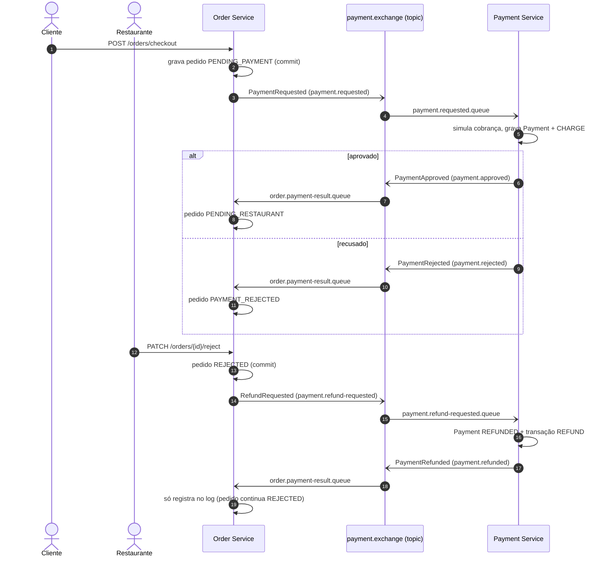

# Food Delivery

## Arquitetura proposta


## Responsabilidades de cada microsserviço

## 1. User Service

Funcionalidades:
- Cadastro de usuários.
- Login e autenticação JWT.
- Controle de permissões por perfil.
- Gerenciamento de dados pessoais.
- Cadastro e gerenciamento de endereços.

Entidades:
- `User`
- `Address`

Perfis:
- `CUSTOMER`
- `RESTAURANT_OWNER`
- `ADMIN`

Endpoints:

```
POST   /users/register
POST   /users/login
GET    /users/{id}
PUT    /users/{id}
POST   /users/{id}/addresses
GET    /users/{id}/addresses
```

## 2. Restaurant Service

Responsável pelos estabelecimentos cadastrados na plataforma.

Funcionalidades:
- Cadastro e edição de restaurantes.
- Associação do proprietário ao restaurante.
- Cadastro de horários de funcionamento.
- Controle de restaurante aberto/fechado.
- Consulta de restaurantes disponíveis.

Entidades:
- `Restaurant`
- `OperatingHours`

Endpoints:

```
POST   /restaurants
GET    /restaurants
GET    /restaurants/{id}
PUT    /restaurants/{id}
PATCH  /restaurants/{id}/availability
```

## 3. Catalog Service

Responsável pelos cardápios dos restaurantes.

Funcionalidades:
- Cadastro de categorias.
- Cadastro e edição de produtos.
- Definição de preços.
- Controle de disponibilidade dos produtos.
- Consulta de cardápios por restaurante.

Entidades:
- `Category`
- `Product`

Endpoints:

```
POST   /products
GET    /products/{id}
GET    /restaurants/{id}/products
PUT    /products/{id}
PATCH  /products/{id}/availability
```

## 4. Order Service

Aqui juntamos Cart Service e Order Service.

O carrinho não precisa necessariamente de um microsserviço próprio. Para o escopo de vocês, ele pode ser uma funcionalidade do serviço de pedidos.

Funcionalidades:

- Criar e consultar carrinhos.
- Adicionar, remover e atualizar itens.
- Calcular subtotal.
- Realizar checkout.
- Validar produtos e preços com o Catalog Service.
- Criar e consultar pedidos.
- Controlar status dos pedidos.
- Permitir que restaurantes aceitem ou rejeitem pedidos.
- Atualizar status de preparação.

Entidades:
- `Cart`
- `CartItem`
- `Order`
- `OrderItem`

Endpoints:

```
POST   /cart/items
GET    /cart/{customerId}
PUT    /cart/items/{id}
DELETE /cart/items/{id}

POST   /orders/checkout
GET    /orders/{id}
GET    /orders/customer/{customerId}
GET    /orders/restaurant/{restaurantId}

PATCH  /orders/{id}/accept
PATCH  /orders/{id}/reject
PATCH  /orders/{id}/preparation
```

Uma observação importante: ao criar o pedido, armazenem uma cópia do nome e do preço de cada produto em `OrderItem`. Assim, uma alteração futura no cardápio não modifica pedidos antigos.

## 5. Payment Service

Responsável pelo processamento dos pagamentos.

Funcionalidades:
- Receber solicitações de pagamento.
- Simular pagamento.
- Aprovar ou recusar transações.
- Consultar pagamentos.
- Simular reembolsos.

Entidades:
- `Payment`
- `PaymentTransaction`

Endpoints:

```
GET  /payments/{id}
GET  /payments/order/{orderId}
POST /payments/{id}/refund
```

O processamento inicial será feito por mensagens assíncronas, conforme explico a seguir.

## Fluxo completo do sistema

Com essa arquitetura, o fluxo principal ficaria assim:

1. Cliente realiza login pelo User Service.
2. Consulta restaurantes pelo Restaurant Service.
3. Consulta cardápios pelo Catalog Service.
4. Adiciona produtos ao carrinho pelo Order Service.
5. Solicita checkout pelo Order Service.
6. Order Service consulta Catalog e Restaurant via REST.
7. Order Service cria o pedido e publica `PaymentRequested`.
8. Payment Service processa o pagamento assincronamente.
9. Payment Service publica `PaymentApproved` ou `PaymentRejected`.
10. Order Service atualiza o pedido.
11. Restaurante consulta seus pedidos pendentes e aceita ou rejeita o pedido.
12. Restaurante atualiza a preparação para `PREPARING` e depois `READY`.


## Middleware

Toda comunicação síncrona passa pelo serviço `middleware` (porta **8080**), escrito do zero pelo grupo: a do cliente com os serviços e a do Order com o Catalog e o Restaurant. A comunicação assíncrona (Order ↔ Payment) passa pelo RabbitMQ.

```
Cliente ──► middleware :8080 ──► User | Restaurant | Catalog | Order | Payment
                 ▲                                              │  ▲
                 └──── Order → Catalog / Restaurant ────────────┘  │ AMQP
                                                Order ◄── RabbitMQ ──► Payment
```

| Capacidade | No middleware |
|---|---|
| Comunicação síncrona | Roteamento por tabela de rotas, com os mesmos caminhos de cada serviço |
| Segurança | Valida o JWT do User Service e o papel exigido por rota (protege também Restaurant e Catalog) |
| Resiliência | Timeout, retry com backoff exponencial (só `GET`), circuit breaker por serviço e fallback `503` |
| Observabilidade | Correlation ID, log em JSON, métricas por rota e serviço, estado dos circuitos (`/middleware/health` e painel no Grafana), tracing distribuído no Zipkin |

### Tracing distribuído

Todos os serviços e o middleware enviam spans para o **Zipkin** (http://localhost:9411), com propagação W3C (`traceparent`). Uma requisição aparece como uma árvore só: middleware → serviço → (Order) middleware → Catalog/Restaurant → RabbitMQ → Payment. Para ver: abra o Zipkin, clique em **Run Query** e escolha um trace.

- Os serviços usam Micrometer Tracing com Brave (Boot 4: `spring-boot-starter-zipkin`; Boot 3: `micrometer-tracing-bridge-brave` + `zipkin-reporter-brave`).
- O middleware usa o `HttpClient` do Java, que o Spring não instrumenta. Por isso o `DownstreamClient` cria o span e escreve o `traceparent` à mão.
- No RabbitMQ, `observation-enabled` no template e no listener faz o `traceparent` ir no cabeçalho da mensagem.
- O Correlation ID continua igual. O tracing acrescenta `traceId`/`spanId` aos logs e mostra o tempo de cada etapa.
- Se o Zipkin estiver fora do ar, os spans são descartados e os serviços continuam funcionando.

Detalhes, rotas e comportamento em falhas: [`middleware/README-middleware.md`](middleware/README-middleware.md).

## Mensageria

Order Service e Payment Service conversam pelo **RabbitMQ**. Nenhum dos dois chama o outro por REST e não há classe Java compartilhada: o contrato é a routing key + o JSON.

### Fluxo



### Exchanges, filas e routing keys

| Exchange | Tipo | Declarada por |
|---|---|---|
| `payment.exchange` | topic, durable | Order e Payment |
| `payment.dlx` | direct, durable (dead letter) | Order e Payment |

| Routing key | Evento | Publicado por | Fila de destino | Consumida por |
|---|---|---|---|---|
| `payment.requested` | `PaymentRequested` | Order | `payment.requested.queue` | Payment |
| `payment.refund-requested` | `RefundRequested` | Order | `payment.refund-requested.queue` | Payment |
| `payment.approved` | `PaymentApproved` | Payment | `order.payment-result.queue` | Order |
| `payment.rejected` | `PaymentRejected` | Payment | `order.payment-result.queue` | Order |
| `payment.refunded` | `PaymentRefunded` | Payment | `order.payment-result.queue` | Order |

Cada fila é durable e tem `x-dead-letter-exchange=payment.dlx` e uma DLQ própria: `payment.requested.queue.dlq`, `payment.refund-requested.queue.dlq` e `order.payment-result.queue.dlq`. Cada serviço declara só as filas que consome.

### Payloads

Todos os eventos têm `eventId` (UUID) e `occurredAt` (ISO-8601, UTC). Datas sempre em texto ISO-8601. A mensagem é `application/json`, persistente, com `messageId = eventId` e o header `X-Correlation-ID`. O header `__TypeId__` não é enviado: cada listener lê o JSON no seu próprio record.

`PaymentRequested`

```json
{
  "eventId": "8c1f6f0e-3c4b-4a8e-9f3a-0d2b5c7e9a11",
  "orderId": "4b0b2f8e-6a7d-4f0e-8d3b-2c1a9e8f7d65",
  "customerId": 10,
  "amount": 51.80,
  "paymentMethod": "PIX",
  "requestedAt": "2026-11-19T10:15:30.123",
  "occurredAt": "2026-11-19T13:15:30.123Z"
}
```

`RefundRequested`

```json
{
  "eventId": "…", "orderId": "…", "customerId": 10, "amount": 51.80,
  "reason": "Sem entregador", "requestedAt": "2026-11-19T10:20:00.000", "occurredAt": "2026-11-19T13:20:00Z"
}
```

`PaymentApproved` / `PaymentRejected` / `PaymentRefunded`

```json
{ "eventId": "…", "paymentId": "…", "orderId": "…", "transactionId": "…", "occurredAt": "2026-11-19T13:15:31Z" }
{ "eventId": "…", "paymentId": "…", "orderId": "…", "reason": "Pagamento recusado pela operadora (simulado)", "occurredAt": "…" }
{ "eventId": "…", "paymentId": "…", "orderId": "…", "amount": 51.80, "occurredAt": "…" }
```

### Garantias e tratamento de falhas

| Tema | Como funciona |
|---|---|
| Quando publica | Só depois do commit da transação que gerou o evento (`TransactionSynchronization.afterCommit`). Transação desfeita = nada publicado. |
| Confirmação | `publisher-confirm-type: correlated`, `publisher-returns: true` e `mandatory`. Nack do broker ou mensagem sem rota geram log de erro com o `eventId`. |
| Durabilidade | Exchanges e filas durable, mensagens persistentes. |
| Retry | 3 tentativas no listener (1ª entrega + 2 novas, com espera de 2s e 4s). Depois a mensagem é rejeitada sem requeue e vai para a DLQ. |
| Erro não recuperável | JSON inválido, campo obrigatório faltando, enum desconhecido, valor ≤ 0 ou pedido inexistente no Order: direto para a DLQ, sem retry. |
| Idempotência | Payment: um pagamento por `orderId` (constraint única). `PaymentRequested` repetido não cobra de novo e reenvia o mesmo resultado. Order: resultado de pagamento só é aplicado em pedido `PENDING_PAYMENT`. Estorno repetido ou de pagamento inexistente é descartado com log. |
| Correlation ID | O valor do MDC (`correlationId`, vindo do `X-Correlation-ID` da requisição) vai no header `X-Correlation-ID` da mensagem. O listener coloca esse valor no MDC e limpa no final, então as linhas de log dos dois serviços têm o mesmo ID. |
| Health | `/actuator/health` inclui `rabbit` (UP/DOWN). `/actuator/prometheus` expõe as métricas do Spring AMQP. |

**Limitação conhecida (sem Outbox):** se o broker cair entre o commit e o envio, o evento se perde. O serviço registra `EVENTO PERDIDO` no log e o pedido fica em `PENDING_PAYMENT`. A correção definitiva é um Transactional Outbox.

### Como testar localmente

```bash
# 1. Sobe o projeto inteiro (os 5 serviços, os bancos, RabbitMQ e observabilidade).
#    ORDER_PROFILES=stub faz o Order usar H2 e Catalog/Restaurant falsos.
#    PAYMENT_APPROVAL_RATE=1.0 aprova tudo (padrão 0.8).
ORDER_PROFILES=stub PAYMENT_APPROVAL_RATE=1.0 docker compose up -d --build

# 2. Checkout → pagamento → rejeição pelo restaurante → estorno, conferindo cada etapa.
./scripts/e2e-messaging.sh

# 3. Logs com o mesmo correlation id nos dois serviços
docker compose logs order-service payment-service | grep e2e-

# Painel do RabbitMQ (filas, DLQs, publicar mensagem à mão): http://localhost:15672 (guest/guest)
```

Sem `ORDER_PROFILES`, o Order chama o Catalog e o Restaurant de verdade, através do middleware; use os ids reais de produto e restaurante.

Testes automatizados (os de mensageria usam Testcontainers e são pulados se não houver Docker):

```bash
cd OrderService && sh mvnw test
cd PaymentService && sh mvnw test
```

| Serviço | Porta | Banco (porta no host) |
|---|---|---|
| **Middleware** (entrada única) | **8080** | – |
| User | 8081 | `user_db` (5433) |
| Restaurant | 8082 | `restaurant_db` (5435) |
| Catalog | 8083 | `catalog_db` (5434) |
| Order | 8084 | `order_db` (5436) |
| Payment | 8085 | `payment_db` (5437) |
| RabbitMQ | 5672 (AMQP), 15672 (painel) | – |
| Prometheus | 9090 | – |
| Grafana | 3000 (admin/admin) | – |
| Zipkin | 9411 | – |

